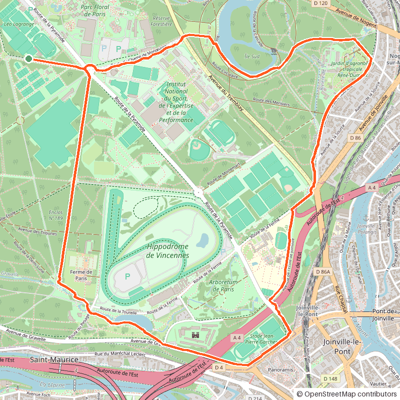

# Dora

**Loop routes that start and finish at your door, at the distance you want, on the ways you like.**
For running, hiking and cycling. Self-hosted, on [BRouter](https://github.com/abrensch/brouter) and OpenStreetMap.

*Named after Dora the Explorer: Dora explores the map, you just run.*

Ask for *10 km of running around this park, quiet paths please* and get back a few distinct loops, each with a GPX file
for your watch, a map image and stats: how much is on paths away from cars and crowds, how many streets you cross, how
much climb, and how much of it you have never run before.



*8.0 km · 59 % away from cars and crowds · 20 crossings · 65 % on waymarked trails · 25 m climb*

> 🚧 Early development: the library works; the HTTP API comes next. See the
> [project board](https://github.com/users/Constantin-Hentgen/projects/14).

## Why

Most route planners go from A to B. Loop generators exist, but they re-rank whatever a generic router returns. Dora
routes with **custom BRouter profiles** that prefer the right ways *while routing*, then checks every loop for the
things that ruin a run: dead-end spurs your watch would send you into, out-and-back sections, a distance that is off.

## Quick start

```sh
git clone https://github.com/Constantin-Hentgen/Dora && cd Dora
cp .env.example .env          # optional: change SEGMENTS_BBOX if you are not in France
docker compose up -d          # first start downloads the BRouter map tiles (~1.5 GB for France)
curl localhost:8000/health
```

As a library (`pip install dora-routes`, needs a BRouter: the compose stack, or `BROUTER_URL`):

```python
from dora_routes import find_loops_sync, to_gpx

result = find_loops_sync(start={"lat": 48.835, "lon": 2.44}, distance_km=8)
for i, loop in enumerate(result.loops, 1):
    print(loop.caption)
    open(f"loop-{i}.gpx", "wb").write(to_gpx(loop.points, f"Loop {i}"))
```

## Documentation

Everything else lives in the [wiki](https://github.com/Constantin-Hentgen/Dora/wiki): configuration, self-hosting,
the API, how loops are built and scored.

## Licence

[MIT](LICENSE). Map data © [OpenStreetMap contributors](https://www.openstreetmap.org/copyright), available under the
[ODbL](https://opendatacommons.org/licenses/odbl/): keep the attribution on maps and GPX files you share.
